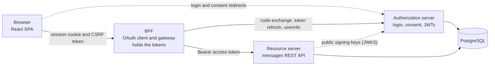
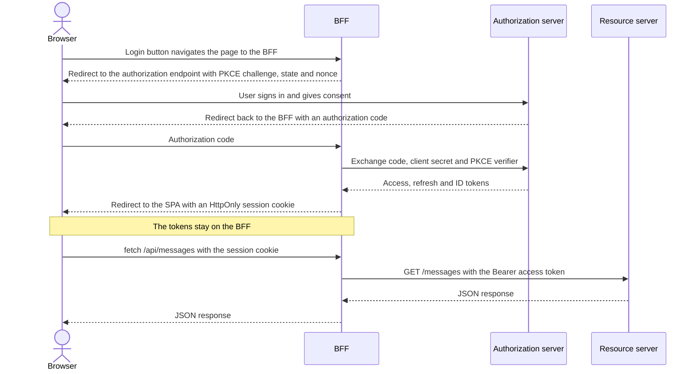

# BFF Pattern

A full-stack implementation of the Backend for Frontend (BFF) pattern, built to the requirements of
[RFC 10017](https://www.rfc-editor.org/rfc/rfc10017.txt), the IETF's Best Current Practice for OAuth 2.0 in
browser-based apps. A React single-page app signs users in with OAuth 2.0 and OpenID Connect, but no token ever
reaches the browser. A Spring Boot BFF keeps the tokens on the server, and the browser only gets an `HttpOnly`
session cookie.

The project covers the whole OAuth setup, not just the client. The authorization server, the BFF and the resource
server are three separate Spring Boot services, so login isn't handed off to a hosted identity provider. A small
message board is the demo application, so the focus stays on the security architecture.
A [comparison against the RFC](#compared-with-rfc-10017) shows which requirements are met and which aren't yet.

This project is part of my [thesis](https://www.theseus.fi/items/241cb384-f10b-46c3-8ff4-0a3eb0b4cba4) (in Finnish).

**Tech stack**

| Area             | Technologies                                                                                                          |
|------------------|-----------------------------------------------------------------------------------------------------------------------|
| Backend          | Java 21, Spring Boot, Spring Security, Spring Authorization Server, Spring Cloud Gateway Server MVC, Spring Data JDBC |
| Frontend         | React, TypeScript, Vite, TanStack Query                                                                               |
| Data and tooling | PostgreSQL, Docker Compose, Gradle, pnpm                                                                              |
| Testing          | JUnit, Mockito, MockMvc, WebTestClient, Testcontainers, MockWebServer                                                 |

**What this project shows**

- Implementing OAuth 2.0 and OpenID Connect end to end: the authorization server, the OAuth client and the resource
  server
- Designing a multi-service system with clear boundaries between authentication, routing and business logic
- Applying web security in practice: token handling, CSRF, CORS, cookies and per-user data access
- Testing at several levels, including integration tests against a real PostgreSQL database
- Assessing my own work against a current standard and being explicit about what is missing

## Why a BFF

A single-page app runs entirely in the browser, so it can't keep a client secret, and malicious script running on the
page (XSS) can steal any token the app stores. The BFF pattern moves the OAuth client to a small backend, and the SPA
talks to that backend with a session cookie.

[RFC 10017](https://www.rfc-editor.org/rfc/rfc10017.txt), the IETF's Best Current Practice for OAuth in browser-based
apps, strongly recommends this architecture for business applications, sensitive applications and applications that
handle personal data.

A BFF doesn't make XSS harmless: injected code can still send requests through the user's session while the page is
open. What it prevents is stealing the tokens and using them somewhere else.

## Architecture

| Service                                        | Port | Responsibility                                                                                                                                         |
|------------------------------------------------|------|--------------------------------------------------------------------------------------------------------------------------------------------------------|
| [`spa`](spa)                                   | 5173 | React UI. Holds no tokens and calls the BFF with `credentials: "include"`.                                                                             |
| [`bff`](bff)                                   | 8080 | Confidential OAuth client and API gateway. Keeps the tokens server-side, relays the access token on proxied requests and refreshes it when it expires. |
| [`authorization-server`](authorization-server) | 9000 | Handles login and consent, and issues signed JWTs with a custom `user_id` claim.                                                                       |
| [`resource-server`](resource-server)           | 8090 | Stateless REST API. Validates JWTs, checks scopes and limits each user to their own data.                                                              |

### Login flow

Access tokens live for five minutes. When one expires, the BFF gets a new one with the refresh token, and the SPA
doesn't notice.

## Security design

| Threat                      | Defence                                                                                                               | Where                                                                                                                            |
|-----------------------------|-----------------------------------------------------------------------------------------------------------------------|----------------------------------------------------------------------------------------------------------------------------------|
| Token theft through XSS     | Tokens never reach the browser. The session cookie is `HttpOnly`.                                                     | [`bff/application.yaml`](bff/src/main/resources/application.yaml)                                                                |
| Cross-site request forgery  | Spring Security's SPA CSRF support. The SPA reads the `XSRF-TOKEN` cookie and returns it in an `X-XSRF-TOKEN` header. | [`SecurityConfig.java`](bff/src/main/java/com/pinkkila/bff/security/SecurityConfig.java), [`queries.ts`](spa/src/lib/queries.ts) |
| Calls from other origins    | CORS allows one origin and only the two request headers the SPA needs.                                                | [`CorsConfig.java`](bff/src/main/java/com/pinkkila/bff/security/CorsConfig.java)                                                 |
| Stolen authorization code   | Authorization code flow with PKCE (S256), `state` and `nonce`, plus client authentication.                            | [`bff/application.yaml`](bff/src/main/resources/application.yaml)                                                                |
| Forged tokens               | The resource server verifies RS256 signatures against the authorization server's public keys.                         | [`resource-server/SecurityConfig.java`](resource-server/src/main/java/com/pinkkila/resourceserver/security/SecurityConfig.java)  |
| Access to other users' data | Every query is filtered by the user ID in the token.                                                                  | [`MessageRepository.java`](resource-server/src/main/java/com/pinkkila/resourceserver/message/MessageRepository.java)             |

### Compared with RFC 10017

Section 6.1 of the RFC lists requirements for a BFF. This is how the project compares:

| Requirement                            | Level  | Status                                                                                                                          |
|----------------------------------------|--------|---------------------------------------------------------------------------------------------------------------------------------|
| Act as a confidential client           | MUST   | **Met.** Uses `client_secret_basic`.                                                                                            |
| `HttpOnly` cookies                     | MUST   | **Met for the session cookie.** The CSRF cookie has to stay readable so that the SPA can send it back. It holds no credentials. |
| Implement a CSRF defence               | MUST   | **Met.** CSRF token and restrictive CORS.                                                                                       |
| `Secure` cookies                       | MUST   | **Not met in this setup.** Local development runs on plain HTTP.                                                                |
| Require a custom request header        | SHOULD | **Met** for state-changing requests.                                                                                            |
| `SameSite=Strict`                      | SHOULD | **Met for the session cookie.** This assumes the authorization server is on the same site as the BFF.                           |
| Cookie `Path=/`, no `Domain` attribute | SHOULD | **Met.**                                                                                                                        |
| `__Host-Http-` cookie prefix           | SHOULD | **Not met.** It requires HTTPS.                                                                                                 |

## Engineering decisions

- **401 or redirect, depending on the caller.** A [
  `DelegatingAuthenticationEntryPoint`](bff/src/main/java/com/pinkkila/bff/security/SecurityConfig.java) redirects page
  navigations to login and returns 401 to `fetch` calls, so the SPA never receives a login page as an API response.
- **A separate `user_id` claim.** `sub` holds the username, and
  a [custom claim](authorization-server/src/main/java/com/pinkkila/authorizationserver/security/CustomClaimsConfiguration.java)
  carries the UUIDv7 primary key. Data ownership follows a stable ID instead of a login name.
- **`@CurrentUser` instead of JWT handling in controllers.** A custom [
  `HandlerMethodArgumentResolver`](resource-server/src/main/java/com/pinkkila/resourceserver/security/CurrentUserArgumentResolver.java)
  turns the claim into a typed value. I chose this over `@AuthenticationPrincipal` with SpEL because it is plain Java
  that the compiler can check.
- **A `UserId` value object.** [`UserId`](resource-server/src/main/java/com/pinkkila/resourceserver/userid/UserId.java)
  and its Spring Data JDBC converters stop user IDs from being mixed up with other UUIDs.
- **Ownership checks in the query.** [
  `findByIdAndUserId`](resource-server/src/main/java/com/pinkkila/resourceserver/message/MessageRepository.java) returns
  404 for another user's message, so the API doesn't reveal that it exists.
- **Auth state as server state.** The SPA treats `/userinfo` as an
  ordinary [TanStack Query](spa/src/contexts/AuthContextProvider.tsx) query, and logout clears the cached user and
  messages.

## Known limitations

This is a local development setup. Before production I would change the following:

- **HTTPS and cookies:** Serve everything over HTTPS, then enable `Secure` and the `__Host-Http-` prefix to meet the
  remaining cookie requirements.
- **Logout:** Logout ends the BFF session but not the authorization server session, so the next login needs no password.
  This needs OIDC RP-initiated logout.
- **Secrets:** The client secret is in `application.yaml` and the demo password uses `{noop}`. These belong in a secret
  store and a real password hash.
- **In-memory state:** Sessions, OAuth authorizations and signing keys live in memory, so a restart signs users out and
  the services can't scale horizontally. Spring Session and persistent authorization storage and keys would fix this.
- **Expired sessions in the SPA:** When a session expires, the SPA shows a generic error instead of returning to the
  logged-out view. It needs a global handler for 401 responses.
- **Configuration:** URLs are hard-coded for localhost, and `TRACE` logging is on. Production would use external
  configuration, and would serve the SPA from the same origin as the BFF so that CORS isn't needed.
