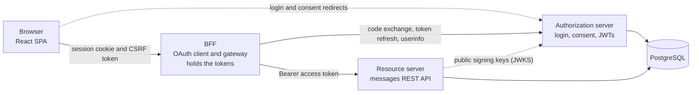
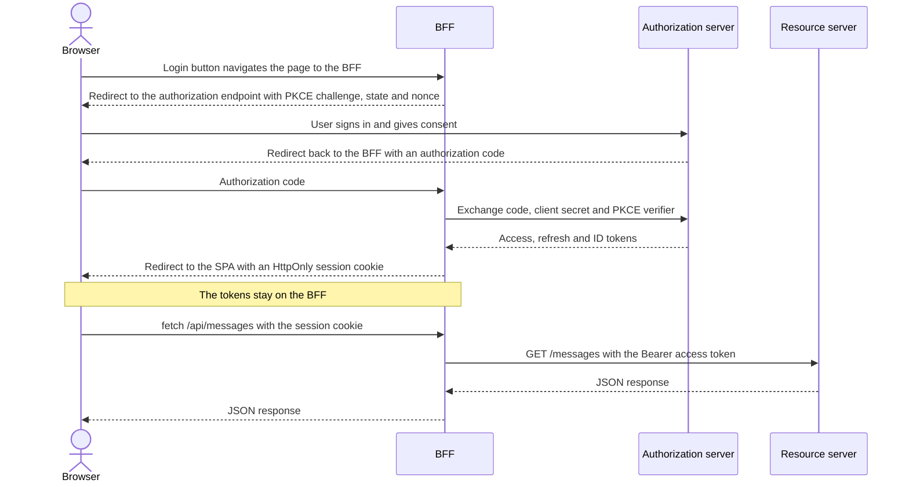

# BFF Pattern

A full-stack implementation of the Backend for Frontend (BFF) pattern, built to the requirements of
[RFC 10017](https://datatracker.ietf.org/doc/html/draft-ietf-oauth-browser-based-apps), the IETF's Best Current Practice
for OAuth 2.0 in browser-based apps. A React single-page app signs users in with OAuth 2.0 and OpenID Connect, but no
token ever reaches the browser. A Spring Boot BFF keeps the tokens on the server, and the browser only gets an
`HttpOnly` session cookie.

The project covers the whole OAuth setup, not just the client. The authorization server, the BFF and the resource
server are three separate Spring Boot services, so login isn't handed off to a hosted identity provider. A small
message board is the demo application, so the focus stays on the security architecture.
A [comparison against the RFC](#compared-with-rfc-10017) shows which requirements are met and which aren't yet.

This project is part of my [thesis](https://www.theseus.fi/items/241cb384-f10b-46c3-8ff4-0a3eb0b4cba4) (in Finnish).

**Tech stack**

| Area             | Technologies                                                                                                       |
|------------------|--------------------------------------------------------------------------------------------------------------------|
| Backend          | Java, Spring Boot, Spring Security, Spring Authorization Server, Spring Cloud Gateway Server MVC, Spring Data JDBC |
| Frontend         | React, TypeScript, Vite, TanStack Query                                                                            |
| Data and tooling | PostgreSQL, Docker Compose, Gradle, pnpm                                                                           |
| Testing          | JUnit, Mockito, MockMvc, WebTestClient, Testcontainers, MockWebServer                                              |


## Architecture



| Service                                        | Port | Responsibility                                                                                                                                         |
|------------------------------------------------|------|--------------------------------------------------------------------------------------------------------------------------------------------------------|
| [`spa`](spa)                                   | 5173 | React UI. Holds no tokens and calls the BFF with `credentials: "include"`.                                                                             |
| [`bff`](bff)                                   | 8080 | Confidential OAuth client and API gateway. Keeps the tokens server-side, relays the access token on proxied requests and refreshes it when it expires. |
| [`authorization-server`](authorization-server) | 9000 | Handles login and consent, and issues signed JWTs with a custom `user_id` claim.                                                                       |
| [`resource-server`](resource-server)           | 8090 | Stateless REST API. Validates JWTs, checks scopes and limits each user to their own data.                                                              |

### Login flow



Access tokens live for five minutes. When one expires, the BFF gets a new one with the refresh token, and the SPA
doesn't notice.

## Compared with RFC 10017

Section 6.1 of the RFC lists requirements for a BFF. This is how the project compares:

| Requirement                            | Level  | Status                                                                                                                          |
|----------------------------------------|--------|---------------------------------------------------------------------------------------------------------------------------------|
| Act as a confidential client           | MUST   | **Met.** Uses `client_secret_basic`.                                                                                            |
| `HttpOnly` cookies                     | MUST   | **Met for the session cookie.** The CSRF cookie has to stay readable so that the SPA can send it back. It holds no credentials. |
| Implement a CSRF defence               | MUST   | **Met.** CSRF token and restrictive CORS.                                                                                       |
| `Secure` cookies                       | MUST   | **Not met in this setup.** Local development runs on plain HTTP.                                                                |
| Require a custom request header        | SHOULD | **Met** for state-changing requests.                                                                                            |
| `SameSite=Strict`                      | SHOULD | **Met for the session cookie.** This assumes the authorization server is on the same site as the BFF.                           |
| Cookie `Path=/`, no `Domain` attribute | SHOULD | **Met.**                                                                                                                        |
| `__Host-Http-` cookie prefix           | SHOULD | **Not met.** It requires HTTPS.                                                                                                 |

## Running locally

**Prerequisites:** JDK 21, Docker, Node.js 20.19 or later, and pnpm.

Each service runs in its own terminal. Start them in this order, because the BFF reads the authorization server's
configuration at startup. Spring Boot's Docker Compose support starts PostgreSQL from [`compose.yaml`](compose.yaml)
automatically.

```bash
# 1. Authorization server, port 9000
cd authorization-server && ./gradlew bootRun

# 2. Resource server, port 8090
cd resource-server && ./gradlew bootRun

# 3. BFF, port 8080
cd bff && ./gradlew bootRun

# 4. SPA, port 5173
cd spa && pnpm install && pnpm dev
```

Open http://localhost:5173 and sign in as `user` with the password `password`. Use `localhost`, not `127.0.0.1`.
CORS only allows `http://localhost:5173`, and the cookies depend on every service being on the same site.

### Running the tests

```bash
cd <service> && ./gradlew test
```

The authorization server and resource server tests use Testcontainers, so Docker has to be running.

## Known limitations

This is a local development setup. Before production at least the following should be changed:

- **HTTPS and cookies:** Serve everything over HTTPS, then enable `Secure` and the `__Host-Http-` prefix to meet the
  remaining cookie requirements.
- **Logout:** Logout ends the BFF session but not the authorization server session, so the next login needs no password.
  This needs OIDC RP-initiated logout.
- **Secrets:** The client secret is in `application.yaml` and the demo password uses `{noop}`. These belong in a secret
  store and a real password hash.
- **In-memory state:** Sessions, OAuth authorizations and signing keys live in memory, so a restart signs users out and
  the services can't scale horizontally. Spring Session and persistent authorization storage and keys would fix this.
- **Expired sessions in the SPA:** When a session expires, the SPA shows a generic error instead of returning to the
  logged-out view. It needs a global handler for 401 responses.
- **Configuration:** URLs are hard-coded for localhost, and `TRACE` logging is on. Production would use external
  configuration, and would serve the SPA from the same origin as the BFF so that CORS isn't needed.
